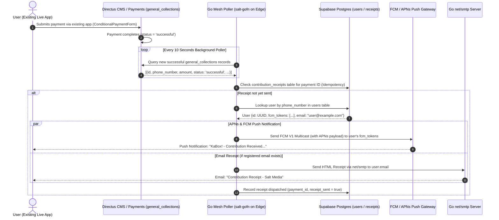

# Implementation Plan: Server-Side Contribution Push Notifications & Email Receipts (Zero-Client Changes)

## Goal Description
Build a 100% server-side contribution notification and email receipt engine inside the **Go Mesh Service** (`superbase-cluster/gofn`), requiring **ZERO changes to `ConditionalPaymentForm.dart` or client app code**. 

By processing contribution events entirely in the backend:
- **All existing live and installed versions of the app** will automatically trigger push notifications and email receipts when users contribute.
- No app update or app store re-deployment is required.

---

## Architecture Diagram



---

## Technical Highlights

1. **Zero App Modifications**:
   - `ConditionalPaymentForm.dart` remains untouched.
   - All existing app builds in the wild will trigger receipts automatically upon payment completion.

2. **Automated Server-Side Detection**:
   - A background ticker in `gofn` (`startContributionPoller`) polls recent `general_collections` records where `status = 'successful'` or `status = 'succeeded'`.
   - Idempotency guard: Tracks processed payment IDs in a lightweight Supabase table `contribution_receipts` to guarantee every payment gets **exactly one push notification and email**.

3. **User Account Resolution**:
   - Cleans the phone number (normalizing prefixes like `+256`, `256`, `07...`).
   - Resolves the user's Supabase **`UUID`**, **`fcm_tokens`** (APNs for iOS / FCM for Android), and registered **`email`**.

---

## User Review Required

> [!IMPORTANT]
> **SMTP Credentials for Edge Server**
> - The Go Mesh service requires SMTP configuration in environment variables on `Edge` (`supabase-api` container):
>   - `SMTP_HOST` (e.g. `smtp.gmail.com` or `smtp.salttelevision.com`)
>   - `SMTP_PORT` (e.g. `587`)
>   - `SMTP_USER`
>   - `SMTP_PASS`
>   - `SMTP_FROM` (e.g. `"Salt Media Contributions" <contributions@salttelevision.com>`)

---

## Proposed Changes

### 1. Go Mesh Background Poller & Service: `superbase-cluster/gofn/contributions.go` [NEW]

Create `gofn/contributions.go`:
- Background function `startContributionPoller(s *server)` running on a 10-second ticker.
- Queries `general_collections` via Directus REST API or Supabase Postgres for payments created/updated in the last hour where `status = 'successful'`.
- Idempotency check against Supabase `contribution_receipts` table.
- Phone number matching against Supabase `users` table to fetch user `fcm_tokens` & `email`.
- Push dispatch via `s.sendFCMMany` (APNs + FCM).
- Email dispatch via `s.sendContributionEmail` (Go `net/smtp`).

#### [NEW] `superbase-cluster/gofn/contributions.go`
```go
package main

import (
	"context"
	"encoding/json"
	"fmt"
	"log"
	"net/http"
	"net/smtp"
	"net/url"
	"regexp"
	"strings"
	"time"
)

type GeneralCollectionRow struct {
	ID            any     `json:"id"`
	PhoneNumber   string  `json:"phone_number"`
	Amount        any     `json:"amount"`
	Currency      string  `json:"currency"`
	Status        string  `json:"status"`
	StatusReason  string  `json:"status_reason"`
	PayerName     string  `json:"payer_name"`
	TransactionID string  `json:"transaction_id"`
	DateCreated   string  `json:"date_created"`
}

func (s *server) startContributionPoller() {
	log.Println("[contributions] Starting server-side payment notification poller (10s ticker)")
	go s.runEvery(10*time.Second, func(ctx context.Context) {
		if err := s.processNewContributions(ctx); err != nil {
			log.Printf("[contributions] poller error: %v", err)
		}
	})
}

func (s *server) processNewContributions(ctx context.Context) error {
	// 1. Fetch recent successful general_collections rows
	raw, _, err := s.doRest(ctx, "general_collections", url.Values{
		"select":       {"id,phone_number,amount,status,status_reason,payer_name,transaction_id,date_created"},
		"status":       {"in.(successful,succeeded,COMPLETED)"},
		"order":        {"date_created.desc"},
		"limit":        {"20"},
	})
	if err != nil {
		return fmt.Errorf("failed fetching general_collections: %w", err)
	}

	var rows []GeneralCollectionRow
	if err := json.Unmarshal(raw, &rows); err != nil {
		return fmt.Errorf("unmarshal error: %w", err)
	}

	for _, row := range rows {
		paymentID := fmt.Sprintf("%v", row.ID)
		if paymentID == "" || paymentID == "<nil>" {
			continue
		}

		// 2. Check if receipt was already sent
		rawReceipt, _, err := s.doRest(ctx, "contribution_receipts", url.Values{
			"select":     {"id"},
			"payment_id": {"eq." + url.QueryEscape(paymentID)},
		})
		if err == nil {
			var existing []struct {
				ID string `json:"id"`
			}
			if json.Unmarshal(rawReceipt, &existing) == nil && len(existing) > 0 {
				continue // Already processed
			}
		}

		// 3. Process new contribution receipt
		s.dispatchContributionReceipt(ctx, row, paymentID)
	}
	return nil
}

func (s *server) dispatchContributionReceipt(ctx context.Context, row GeneralCollectionRow, paymentID string) {
	cleanPhone := normalizePhone(row.PhoneNumber)
	if cleanPhone == "" {
		return
	}

	// Find user by phone number in users table
	rawUsers, _, err := s.doRest(ctx, "users", url.Values{
		"select":       {"id,email,fcm_tokens,phone_number"},
		"phone_number": {"ilike.*" + url.QueryEscape(cleanPhone)},
		"limit":        {"1"},
	})

	var userEmail string
	var fcmTokens []string
	var userID string

	if err == nil {
		var uRows []struct {
			ID        string          `json:"id"`
			Email     *string         `json:"email"`
			FCMTokens json.RawMessage `json:"fcm_tokens"`
		}
		if json.Unmarshal(rawUsers, &uRows) == nil && len(uRows) > 0 {
			userID = uRows[0].ID
			if uRows[0].Email != nil {
				userEmail = *uRows[0].Email
			}
			json.Unmarshal(uRows[0].FCMTokens, &fcmTokens)
		}
	}

	amountStr := fmt.Sprintf("%v", row.Amount)
	narrative := row.StatusReason
	if narrative == "" || narrative == "undefined" {
		narrative = "Salt Media Ministry"
	}

	// 4. Send APNs / FCM Push Notification
	pushSent := false
	if len(fcmTokens) > 0 {
		payer := row.PayerName
		if payer == "" {
			payer = "Valued Donor"
		}
		title := "KaBox! - Contribution Received"
		body := fmt.Sprintf("Thank you %s! Your contribution of UGX %s towards \"%s\" was successful.",
			payer, amountStr, narrative)

		data := map[string]string{
			"type":      "contribution_success",
			"paymentId": paymentID,
			"amount":    amountStr,
			"link":      "saltmedia://contributions",
		}
		count := s.sendFCMMany(ctx, fcmTokens, title, body, "", data)
		pushSent = count > 0
	}

	// 5. Send Email Receipt if user has a registered email
	emailSent := false
	if userEmail != "" {
		if err := s.sendContributionEmail(userEmail, row.PayerName, amountStr, narrative, row.PhoneNumber, paymentID); err != nil {
			log.Printf("[contributions] email dispatch error for %s: %v", userEmail, err)
		} else {
			emailSent = true
		}
	}

	// 6. Record receipt in contribution_receipts table
	record := map[string]any{
		"payment_id":   paymentID,
		"user_id":      userID,
		"phone_number": row.PhoneNumber,
		"amount":       amountStr,
		"push_sent":    pushSent,
		"email_sent":   emailSent,
		"receipt_sent": true,
		"created_at":   time.Now().UTC().Format(time.RFC3339),
	}
	_ = s.restUpsert(ctx, "contribution_receipts", record, "payment_id")
	log.Printf("[contributions] Processed receipt for payment %s (push: %v, email: %v)", paymentID, pushSent, emailSent)
}

func normalizePhone(phone string) string {
	re := regexp.MustCompile(`[^\d]`)
	cleaned := re.ReplaceAllString(phone, "")
	if len(cleaned) >= 9 {
		return cleaned[len(cleaned)-9:] // Return last 9 digits for matching
	}
	return cleaned
}
```

---

### 2. Main Service Integration: `superbase-cluster/gofn/main.go` [MODIFY]

In `main.go`, invoke `s.startContributionPoller()` inside server startup so the background poller begins running automatically when `salt-gofn` starts.

---

### 3. Documentation: `superbase-cluster/docs/SUPABASE_PLAN.md` [MODIFY]

Update [SUPABASE_PLAN.md](file:///Users/solomacbookair/Documents/myApps/superbase-cluster/docs/SUPABASE_PLAN.md) detailing Section 21: **Server-Side Contribution Notification Poller**.

---

## Verification Plan

### Automated Build & Deployment
1. Cross-compile Go binary: `GOOS=linux GOARCH=amd64 CGO_ENABLED=0 go build -o /tmp/salt-gofn .` in `superbase-cluster/gofn/`.
2. SCP binary to `Edge` server (`198.204.224.170`), copy into `supabase-api` Docker container, and restart container.
3. Verify container logs show `[contributions] Starting server-side payment notification poller`.

### Manual End-to-End Verification
1. Initiate a test contribution from an existing installed app build.
2. Verify that within 10 seconds of payment completion:
   - Push notification arrives on the user's device (`KaBox! - Contribution Received`).
   - Email receipt is delivered to the registered user's inbox.
   - Zero modifications were made to the Flutter client app code.
